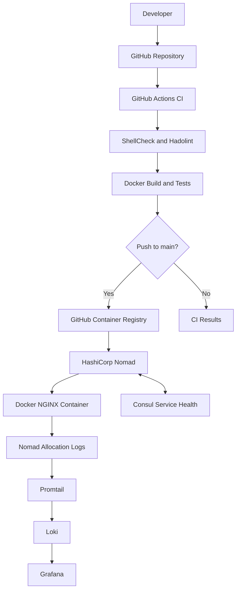
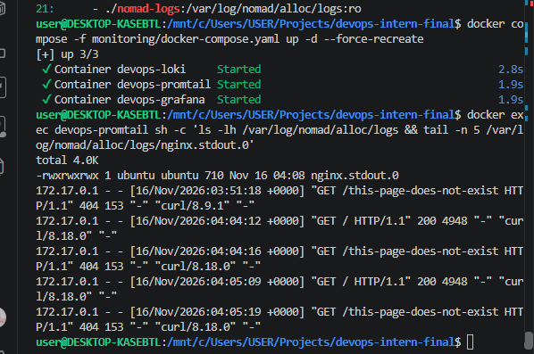
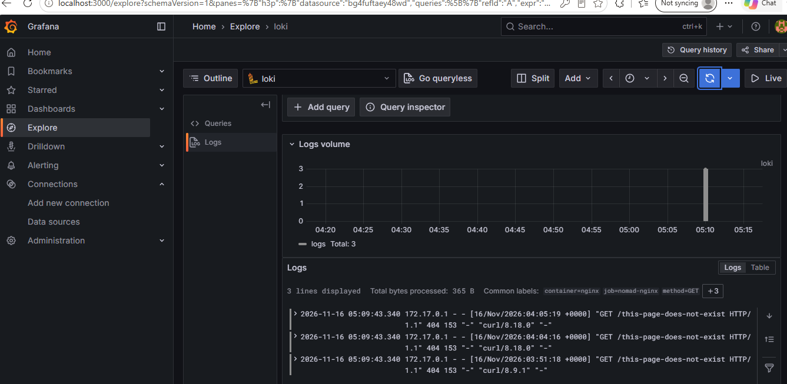

# DevOps Internship Final Project


A containerized web application deployment and monitoring pipeline demonstrating practical DevOps workflows using Docker, GitHub Actions, HashiCorp Nomad, Consul, Loki, Promtail and Grafana.

- **Project:** DevOps Internship Final Project
- **Author:** Iyen Paul
- **Submission date:** 15 November 2026
- **Repository:** https://github.com/pmman-sudo/devops-intern-final

---

## 1. Project Overview

This project takes a static NGINX web application and builds an automated deployment and monitoring workflow around it.

The implementation covers:

- Linux system information and application health-check scripts.
- Secure containerization with an unprivileged NGINX image.
- Automated linting, image building and application testing through GitHub Actions.
- Conditional Docker image publishing to GitHub Container Registry (GHCR).
- Container orchestration with Nomad.
- Service registration and health checking through Consul.
- Centralized log collection and querying with Loki and Promtail.
- Log visualization using Grafana.

The goal is to demonstrate the practical lifecycle of a containerized application, from source control and validation through deployment and operational monitoring.

## 2. Architecture



### Application request flow

1. A browser sends an HTTP request to the NGINX application.
2. NGINX serves the static website on port `8080`.
3. The `/healthz` endpoint returns HTTP 200 when the application is healthy.
4. Nomad manages the application allocation.
5. Consul receives the registered service and monitors its HTTP health check.
6. Promtail collects the available NGINX allocation log snapshot and sends entries to Loki.
7. Grafana queries Loki to display and filter application logs.

## 3. Technology Stack

| Technology | Purpose |
|---|---|
| Git and GitHub | Version control and collaboration |
| GitHub Actions | CI/CD automation |
| Docker | Application containerization |
| NGINX | Static web server |
| ShellCheck | Shell script linting |
| Hadolint | Dockerfile linting |
| HashiCorp Nomad | Container orchestration |
| HashiCorp Consul | Service registration and health checks |
| Grafana Loki | Log aggregation and querying |
| Promtail | Log collection and processing |
| Grafana | Monitoring and visualization |

### Verified development environment

| Component | Version |
|---|---|
| Windows | Windows development environment |
| Ubuntu WSL2 | 26.04 |
| Linux kernel | 6.18.58.1-microsoft-standard-WSL2 |
| Git | 2.56.0 |
| Docker Engine | 29.6.2 |
| Docker Compose | 5.3.1 |
| Nomad | 2.1.1 |
| Consul | 2.1.0 |
| ShellCheck | 0.11.0 |

Container image versions are pinned in the Dockerfile and monitoring Compose configuration.

## 4. Repository Structure

```text
devops-intern-final/
├── .github/
│   └── workflows/
│       └── ci.yml
├── app/
│   ├── Dockerfile
│   ├── nginx.conf
│   ├── index.html
│   ├── cheet.css
│   ├── cheet.js
│   └── commands.js
├── docs/
│   └── screenshots/
├── monitoring/
│   ├── docker-compose.yaml
│   ├── loki-config.yaml
│   ├── promtail-config.yaml
│   ├── loki_setup.md
│   └── nomad-logs/
│       └── nginx.stdout.0
├── nomad/
│   └── nginx-app.nomad.hcl
├── scripts/
│   ├── sysinfo.sh
│   └── healthcheck.sh
├── k8s/
├── .gitattributes
├── .gitignore
├── LICENSE
└── README.md
```

The `k8s/` directory contains Kubernetes manifests retained from the original MIT-licensed reference project. The current deployment implementation uses Nomad and Consul.

## 5. Prerequisites

Install or configure:

- Git.
- Docker Desktop with WSL2 integration.
- Ubuntu on WSL2.
- HashiCorp Nomad.
- HashiCorp Consul.
- ShellCheck.
- PowerShell.

Docker must be running and accessible from the Ubuntu WSL2 environment.

## 6. Quick Start: Build and Run

Run these commands from the repository root in PowerShell.

### Build the image

```powershell
docker build `
    --build-arg BUILD_SHA=devops-intern-v1 `
    -t devops-intern-final:v1.0.0 `
    -f .\app\Dockerfile `
    .\app
```

### Start the container

```powershell
docker run -d `
    --name devops-intern-readme-demo `
    -p 8081:8080 `
    devops-intern-final:v1.0.0
```

### Verify application health

```powershell
curl.exe -i http://localhost:8081/healthz
```

Expected response:

```text
HTTP/1.1 200 OK
X-Build-SHA: devops-intern-v1

healthy
```

The exact response headers may vary.

### Open the application

http://localhost:8081

### Stop the application

```powershell
docker rm -f devops-intern-readme-demo
```

## 7. Shell Scripts

Two scripts provide basic system inspection and application health verification.

### System information

Run from Ubuntu WSL2:

```bash
./scripts/sysinfo.sh
```

The script reports:

- Current user and effective UID.
- Hostname and kernel information.
- ISO 8601 date.
- Disk usage.
- Memory usage.
- Docker daemon availability and server version.

### Application health check

Run from Ubuntu WSL2:

```bash
./scripts/healthcheck.sh
```

The default target is:

`http://localhost:8081`

A custom URL can be supplied:

```bash
./scripts/healthcheck.sh http://localhost:8081/healthz
```

The script returns exit code `0` for HTTP 200 and a nonzero exit code for an unsuccessful check.

### Shell compatibility note

The scripts use Bash with:

```bash
#!/usr/bin/env bash
set -euo pipefail
```

The assessment specifies both POSIX shell compatibility and `pipefail`. Since `pipefail` is not part of POSIX shell, Bash is used to satisfy the explicit `pipefail` requirement. The scripts should therefore be described as Bash scripts, not strictly POSIX-compliant scripts.

## 8. Docker Implementation

The application uses the pinned base image:

`nginx/nginx-unprivileged:1.31.8-alpine3.24`

Security and runtime features include:

- Unprivileged NGINX runtime user (UID 101).
- Application listening on port `8080`.
- Custom NGINX configuration.
- Dedicated `/healthz` endpoint.
- Docker `HEALTHCHECK`.
- Build identification through the `X-Build-SHA` response header.

### Image size

The locally built image was verified at approximately **23.4 MB**, below the 60 MB target.

The image inspection also confirmed the runtime user is UID 101 and the exposed port is 8080.

## 9. GitHub Actions CI/CD

The workflow is located at:

`.github/workflows/ci.yml`

It runs on pushes to `main` and pull requests targeting `main`.

### Pipeline stages

**Lint**

- Installs ShellCheck.
- Runs ShellCheck against `scripts/*.sh`.
- Runs Hadolint against `app/Dockerfile`.

**Build and test**

- Builds the Docker image.
- Starts a test container.
- Waits for application readiness.
- Runs the health-check script.
- Verifies the `X-Build-SHA` response header.
- Removes the test container.

**Publish**

- Runs only for pushes to `main`.
- Authenticates to GHCR using `GITHUB_TOKEN`.
- Publishes the image with commit SHA and `latest` tags.

The publish job is expected to be skipped on pull request events.

### CI verification

The initial GitHub Actions pull request run completed successfully:

- ShellCheck and Hadolint: passed.
- Docker build and application tests: passed.
- GHCR publishing: skipped as expected for a pull request.

GitHub also displayed Node.js 20 deprecation and Ubuntu runner migration notices. These were warnings, not failed checks.

## 10. Nomad and Consul Deployment

The Nomad job specification is:

`nomad/nginx-app.nomad.hcl`

The job defines:

- A service job with one NGINX task.
- Docker driver.
- Dynamic host port mapped to container port 8080.
- CPU allocation of 100 MHz.
- Memory allocation of 64 MB.
- Consul service registration.
- HTTP health check on `/healthz`.
- Restart and rescheduling policies.
- Deployment health settings and automatic rollback.

The resource values are development/demo allocations rather than production capacity recommendations.

### Validate the job

From PowerShell:

```powershell
wsl -d Ubuntu -- nomad job validate /mnt/c/Users/USER/Projects/devops-intern-final/nomad/nginx-app.nomad.hcl
```

### Plan the deployment

```powershell
wsl -d Ubuntu -- nomad job plan /mnt/c/Users/USER/Projects/devops-intern-final/nomad/nginx-app.nomad.hcl
```

### Submit the job

```powershell
wsl -d Ubuntu -- nomad job run /mnt/c/Users/USER/Projects/devops-intern-final/nomad/nginx-app.nomad.hcl
```

### Inspect deployment status

```powershell
wsl -d Ubuntu -- nomad job status nginx-app
```

Inspect registered Consul health checks:

```powershell
curl.exe -s http://localhost:8500/v1/health/checks/nginx-app
```

### Deployment verification

The local Nomad deployment reached:

- Desired allocations: 1.
- Placed allocations: 1.
- Healthy allocations: 1.
- Unhealthy allocations: 0.

The Consul HTTP health check reported `passing`.

The application was also tested through the dynamically assigned Nomad host port.

## 11. Monitoring with Loki, Promtail and Grafana

The monitoring stack is defined in:

`monitoring/docker-compose.yaml`

### Start monitoring

```powershell
docker compose -f .\monitoring\docker-compose.yaml up -d
```

### Verify services

```powershell
docker compose -f .\monitoring\docker-compose.yaml ps
```

### Access the interfaces

| Service | Local URL |
|---|---|
| Loki | http://localhost:3100/ready |
| Grafana | http://localhost:3000 |

Grafana's local demonstration credentials are configured in the Compose file. They are for local testing only and must not be reused in production.

### Grafana configuration

Configure a Loki data source using:

`http://loki:3100`

Use Grafana Explore to query the collected logs.

### LogQL examples

All application logs:

```logql
{job="nomad-nginx"}
```

Successful HTTP requests:

```logql
{job="nomad-nginx", status="200"}
```

Not-found responses:

```logql
{job="nomad-nginx", status="404"}
```

GET requests:

```logql
{job="nomad-nginx", method="GET"}
```

### Monitoring test results

The collected log snapshot contained seven entries:

| HTTP status | Number of entries |
|---|---:|
| 200 | 4 |
| 404 | 3 |
| Total | 7 |

Grafana Explore successfully filtered the three HTTP 404 entries.

### WSL2 log collection limitation

The Nomad allocation log was accessible inside Ubuntu WSL2, but the attempted direct bind mount of its `/tmp` location was not accessible to the Docker Desktop monitoring containers.

The implemented workaround copies the allocation log into:

`monitoring/nomad-logs/nginx.stdout.0`

Promtail reads that project-shared file through a read-only bind mount.

This is a **snapshot-based demonstration**, not continuous live log streaming. New requests made after the snapshot is copied will not automatically appear in Loki. The file must be refreshed from the allocation log to collect newer entries.

Detailed setup, verification commands and troubleshooting are documented in [`monitoring/loki_setup.md`](monitoring/loki_setup.md).

## 12. Screenshots and Evidence

### Docker Compose and NGINX log inspection



### Grafana HTTP 404 log filtering



## 13. Troubleshooting and Lessons Learned

### 1. Shell script line endings

**Problem:** PowerShell initially wrote shell scripts with Windows line endings and a UTF-8 BOM, which caused execution problems in Linux.

**Resolution:** Converted the scripts to UTF-8 without BOM and Unix LF line endings. Added `.gitattributes` rules to preserve LF for shell scripts.

### 2. Ubuntu WSL2 password access

**Problem:** The Ubuntu user password was unavailable, preventing administrative package installation.

**Resolution:** Used the WSL root account to reset the Ubuntu user's password, then verified `sudo` access.

### 3. Nomad deployment validation

**Problem:** Nomad warned that a service group had no shutdown delay configured.

**Resolution:** Added `shutdown_delay = "5s"` to the task group and validated the job again.

### 4. Docker Desktop and WSL2 log mounts

**Problem:** Docker Desktop could not read the attempted Ubuntu `/tmp` allocation-log bind mount.

**Resolution:** Copied the log into the Windows-shared project directory and mounted that directory into Promtail. This workaround is snapshot-based and is documented as a limitation.

### 5. CI workflow publishing behavior

**Problem:** The GHCR publishing job did not run on the pull request.

**Resolution:** This is intentional. The workflow restricts image publishing to push events on `main`, preventing pull requests from publishing images.

## 14. Known Limitations and Future Improvements

- Promtail currently reads a copied allocation log snapshot rather than a continuously updated Nomad log stream.
- Nomad and Consul are configured for a local development environment, not a production cluster.
- Grafana demonstration credentials are local-only and should be replaced with managed secrets for shared environments.
- The CI workflow publishes commit SHA and `latest` image tags; release version tagging is handled separately.
- The existing Kubernetes manifests are retained as reference material; the current deployment workflow uses Nomad.

Potential future improvements include continuous log forwarding, production-grade secret management, deployment automation for a remote Nomad cluster and additional monitoring alerts.

## 15. License and Attribution

This repository retains the original MIT `LICENSE` from the upstream reference project.

The original application assets and retained Kubernetes manifests originate from:

https://github.com/FanoyG/containerized-web-app-docker-kubernetes

The DevOps pipeline, container configuration, scripts, Nomad deployment, monitoring configuration and associated documentation were developed as extensions for this project.

---

## 16. Project Status

The local application build, health checks, Nomad deployment, Consul health verification, Loki ingestion and Grafana log filtering have been tested.

The GitHub Actions pull request checks for linting and Docker build/test have passed.

GHCR publication, final merge and release tagging are pending completion of the review and merge process.
